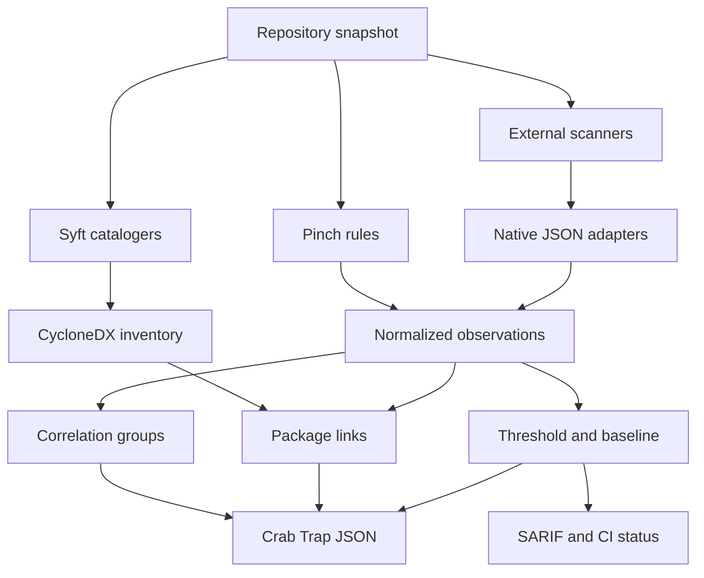

# CRAB architecture

CRAB processes one local repository snapshot per invocation. Pinch parses eligible source files. Broad detection stays with established scanner engines. Their saved reports meet at a versioned adapter boundary. Syft generates a separate CycloneDX inventory.

## Discovery and execution

The original `scan` command emits schema 1 and retains its Python and Dockerfile behavior. `collect` runs those checks plus its HTML, PostgreSQL and Mojo dispatch and emits an additive schema 2 report. Missing optional parsers and unparseable files count as coverage errors. Each successful source file contributes once to `files_scanned`. Report imports are accounted for separately.

Built-in checks read regular UTF-8 files of up to 1 MiB and skip symlinks and common generated directories. SQLFluff receives SQL text with a fixed PostgreSQL dialect. The Mojo parser loads an explicitly supplied native grammar from outside the target checkout. The CLI never compiles target code. Run the installed CLI outside the target, and run external scanners with trusted settings in an isolated worker. Use a stable read-only snapshot, resource limits and a network policy appropriate for that worker.

The Syft subprocess uses an explicit directory source, a temporary working directory, a restricted environment and a 180-second timeout. CRAB checks the CycloneDX envelope and replaces an output file only after generation succeeds. Its generated or imported inventory limit is 32 MiB. Normal report imports are bounded at 16 MiB each.

## Observations, groups and inventory

| Entity | Identity and purpose |
|---|---|
| Import | Ordinal, producer, version, rule pack and status. Direct imports can lack upstream metadata. A run manifest supplies the revision, versions, rule packs and process completion status. |
| Observation | Producer, rule/advisory, normalized and original severity, location, fingerprint and curated message. Available evidence includes source extent, Bandit confidence, Checkov resource, package metadata or image manifest digest. |
| Group | A list of observation fingerprints, revision, mapping version and highest recorded severity. A singleton is valid. |
| Component | A cataloged component in the supplied CycloneDX inventory. Links use the exact package URL and installed version. Each side can contain unmatched records. |

Exact duplicates within a producer share an observation. Import indices retain their provenance. Ranking uses severity first and stable identity fields for tie-breaking. When duplicate severities disagree, the highest severity takes precedence. Rule equivalence map v1 connects CRAB-PY-001 and Bandit B323 only when both reports describe the same file and complete byte extent. Colocated findings with different spans remain independent.

Dependency grouping requires the same versioned package URL, installed version and artifact scope. Within that scope, equal advisory IDs and explicit OSV aliases connect transitively. CRAB derives URLs for familiar package ecosystems when the scanner omitted one. Unknown ecosystems need an explicit URL for correlation. Filesystem findings are scoped to their manifest. Image findings include a validated sha256 digest, and image-internal locations never become checkout annotations. The optional repository SBOM joins repository findings only.

The repository revision is caller-supplied. CRAB does not authenticate a report or attest the snapshot associated with a standalone SBOM. Generate and retain inputs together in CI. The mapping version and revision in each group make repeated comparisons interpretable.

## Reporting and policy

`collect --format sarif` exports SARIF 2.1.0 from observations, with repository-relative URI-encoded locations, available line ranges and stable partial fingerprints. Image-only findings retain their advisory and severity. The run invocation carries coverage failures. JSON additionally exposes groups, input provenance and inventory joins.

Reviewed baseline entries target exact observation fingerprints and contain a reviewer and reason. Matching findings stay visible and are marked suppressed. Severity thresholds apply to remaining observations. Exit 2 has precedence over both findings and suppressions, exit 1 indicates actionable observations, and exit 0 indicates the specified policy passed within measured coverage.

[Native report formats and commands](integrations.md) · [Language coverage](coverage.md) · [SARIF specification](https://docs.oasis-open.org/sarif/sarif/v2.1.0/sarif-v2.1.0.html)
