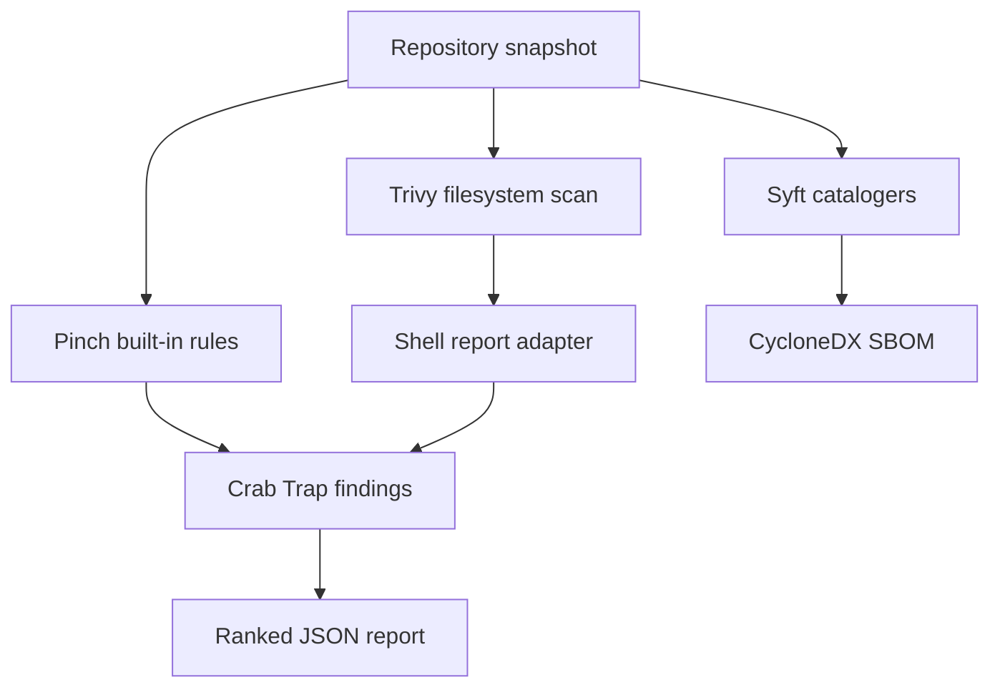

# CRAB architecture

CRAB is a local orchestration and reporting CLI. Trusted built-in rules handle two small checks. External engines own package cataloging and broad detection. Their output enters CRAB through explicit adapters.

### Discovery and execution

`scan` walks regular UTF-8 Python and Dockerfile sources, skips symlinks and common generated directories, and reads at most 1 MiB per file. The Python rule matches the literal call spelling. The Dockerfile check uses the last recognized single-line USER in the final stage. Aliases, inherited users, variable expansion and multiline instructions need stronger parsers. `files_scanned` counts successful built-in checks. Zero eligible files is visible as a zero count.

`collect` accepts a local scan and optional saved Trivy schema-2 filesystem reports. The caller supplies reports for the same checkout and revision. CRAB accepts language-package results, rejects other result classes and unsafe paths, and caps input at 16 MiB per report. One invalid report produces a coverage error while valid inputs retain their findings. The adapter selects identity fields and omits free-text descriptions, snippets and scanner diagnostics. A manifest path, line, package name or other identifier is still repository metadata.

`sbom` invokes the trusted Syft binary against a local directory with an explicit source type. The child runs in a temporary directory with a restricted environment, a 180-second timeout and update checks disabled. Syft owns component discovery, package URLs, licenses and dependency relationships when available. CRAB reads up to 32 MiB of generated JSON, checks the document envelope and replaces the requested file after success. The producer's CycloneDX version travels with the document. Inventory can succeed when the findings report is empty.

Use an immutable, read-only snapshot, a worker without credentials, an enforced network policy and OS resource limits when cataloging untrusted submissions. Process timeouts and bounded report reads cover only part of the worker boundary. Independent scanners and rule packs retain their upstream licenses. Record the exact version, license and checksums before distributing a binary or rule pack with CRAB.

### Finding model

| Field | Meaning |
|---|---|
| producer, producer_version, module | Source of the observation, version if supplied, CRAB capability |
| rule, message | Upstream advisory or built-in rule ID and curated remediation text |
| severity, original_severity | Canonical priority and producer's label. Unrecognized labels map to unknown. |
| path, line | Repository-relative evidence path. A dependency finding has a null line. |
| package, manifest | For dependency findings, ecosystem, package name, installed version and Trivy target |
| fingerprint | SHA-256 over an ordered JSON array of identity fields within the snapshot |

A built-in key uses producer, path, line and rule. A dependency key additionally distinguishes package ecosystem, target, installed location, advisory, name and installed version. Re-importing the same observation is idempotent. For conflicting severities the highest known severity wins. Sort order is critical, high, medium, low, unknown, followed by path, line, rule and fingerprint. This initial priority is independent of exploitability or reachability.

For future cross-engine correlation, preserve each observation and form a separate group. Resolve explicit CVE/GHSA aliases and require the same package URL, version and artifact or manifest. A source finding needs a curated rule equivalence and matching source span. Shared CWEs and matching line numbers alone are insufficient. Keep image digest, commit identity and normalization-map version in the group. Link SBOM components by package URL and version while retaining unmatched inventory and advisories.

### Delivery and compatibility

The starter's source-scan JSON remains schema 1. Combined reports use schema 2; consumers can migrate independently. CLI and import identifiers changed from `crab` to `crab-risk-scan` and `crab_risk_scan` to avoid namespace collisions.

| Milestone | Acceptance |
|---|---|
| Local scanner, unified report and SBOM (this release) | Verify clean/finding/incomplete statuses, atomic output, repeat import, unknown severity, canary redaction and a clean dependency in a real Syft inventory. |
| Broad integrations | Follow the per-language fixtures and parser gates in [the coverage matrix](coverage.md). Require producer version, completion status and rule-pack provenance. |
| Cross-engine triage | Preserve evidence under conservative group keys. Export findings with valid file locations to SARIF 2.1.0 and link component identities to CycloneDX. |
| Policy and baselines | Add explicit severity thresholds and reviewed suppressions. Preserve incomplete-scan precedence, even if all findings are suppressed. |

[Trivy reporting](https://trivy.dev/docs/v0.72/guide/configuration/reporting/) · [Syft](https://github.com/anchore/syft) · [CycloneDX JSON reference](https://cyclonedx.org/docs/1.6/json/)
